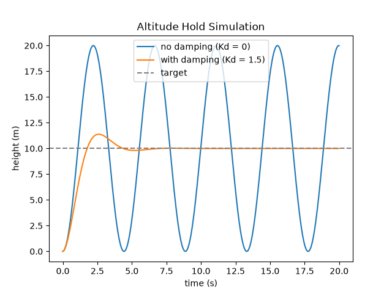

# altitude-hold-pid

A 1-D simulation of a drone holding altitude at 10 m, comparing proportional (P)
control against proportional-derivative (PD) control.

*Blue: P control only (Kd = 0) — oscillates between 0 and 20 m indefinitely.
Orange: PD control (Kd = 1.5) — settles on the target. Dashed line: the 10 m target.*

## The controller

At each timestep the thrust command is

    thrust = m*g + Kp*(target - height) - Kd*velocity

- `m*g` cancels the drone's weight, leaving the remaining terms free to accelerate it
- `Kp*(target - height)` pushes harder the further the drone is from the target
- `Kd*velocity` opposes motion: it brakes the climb, and catches the fall

The state is then advanced one timestep:

    velocity += (thrust - m*g) / m * dt
    height   += velocity * dt

## Parameters

    drone        m = 1.0 kg,  g = 9.81 m/s^2
    target       10.0 m
    gains        Kp = 2.0 N/m,  Kd = 1.5 N*s/m
    simulation   dt = 0.01 s,  20 s total (2000 steps)

## Results

| controller | peak height | settles? |
|---|---|---|
| P only (`Kd = 0`) | 20.0 m | never  (still oscillating at 20s) |
| PD (`Kd = 1.5`) | 11.4 m at 2.6 s | yes (within ±2% by 4.1s) |

## What I learned

Kp on its own allows for huge overshoot, because velocity is not taken into
account, the drone arrives at the target at full speed and goes straight past
it, oscillating between 0 and 20 m forever.

Kd puts velocity into consideration. The minus sign subtracts a large amount
from the thrust when the drone is moving upward fast, which brakes it. When the
drone is falling, velocity is negative, so the same minus sign adds thrust
instead and catches it.

## Running it

    pip install matplotlib
    python altitude_hold.py
